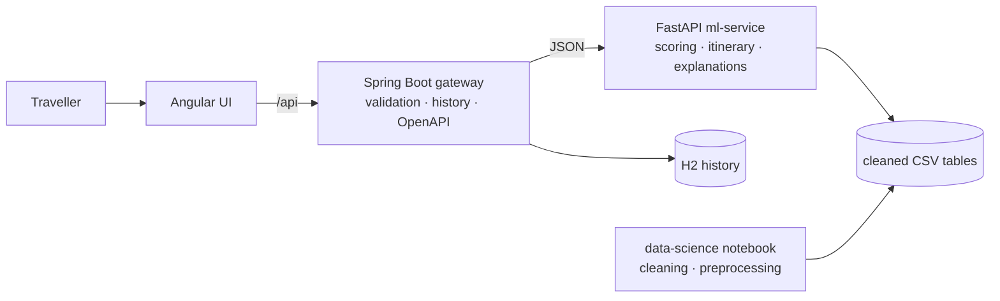
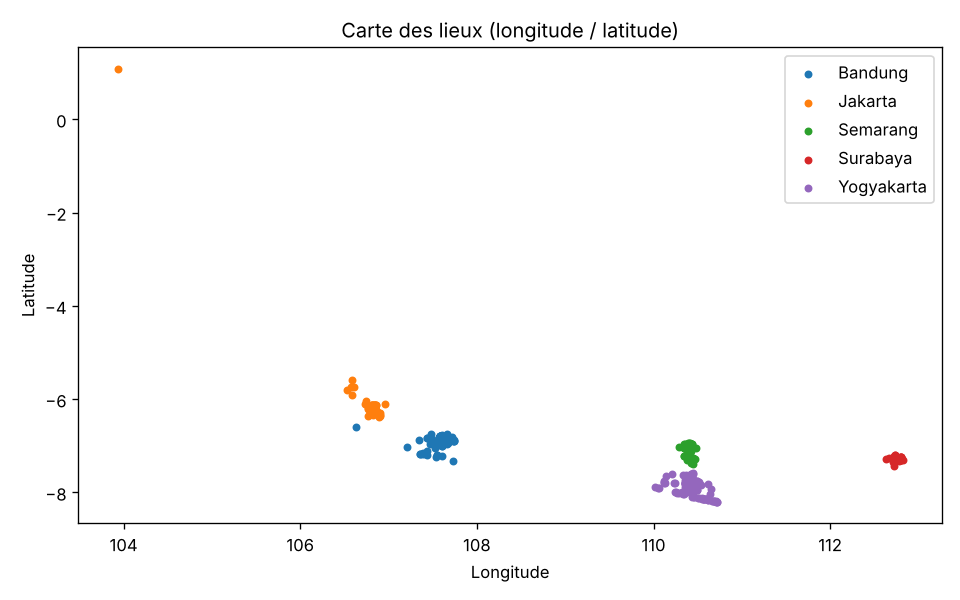

# Itinera — Explainable Travel Recommender & Itinerary Planner

> Tell Itinera what you like, your budget and how many days you have: it ranks the places worth visiting, **explains every suggestion**, and builds a day-by-day itinerary that fits your time and money.


Data: *Indonesia Tourism Destination* dataset — 437 places across Jakarta, Yogyakarta, Bandung, Semarang and Surabaya.

## Features

- **Personalised ranking** from a declared profile (interests per category, budget, trip length, places already liked).
- **Transparent score** — each place gets `Σ weight × component` over interests, quality (Bayesian-smoothed ratings), budget fit and similarity to liked places; a diversity penalty avoids five museums in a row.
- **Explanations generated from the score**, never invented ("matches your interest in culture", "free entry", "similar to a place you liked").
- **Itinerary builder** — greedy day planner that trades distance against score, respects a daily time window (visit + travel time) and the total budget, and reports schedules, costs, distances and warnings.
- **Honest evaluation** — offline benchmark of rating prediction and top-10 ranking showed the dataset's ratings carry no usable individual signal, which is why personalisation relies on the declared profile rather than collaborative filtering ([report](ml-service/reports/evaluation.md)).

## Architecture



The Java backend owns validation, history and error handling (clear 400 / 422 / 502 / 503 responses); all the intelligence lives in a separate Python service, so the model can evolve (embeddings, LLM) without touching the backend. Details in [docs/ARCHITECTURE.md](docs/ARCHITECTURE.md) and [docs/API.md](docs/API.md).

<p align="center"></p>

## Getting started

```bash
git clone https://github.com/eya-dl/Itinera_project.git
cd Itinera_project
docker compose up --build
# UI: http://localhost:4200    API docs: http://localhost:8080/swagger-ui.html
```

Without Docker (three terminals):

```bash
cd ml-service && pip install -r requirements.txt && uvicorn app.main:app --port 8000
cd backend    && mvn spring-boot:run
cd frontend   && npm install && npm start
```

## Project structure

| Folder | Content |
|---|---|
| `data-science/` | raw data, cleaning & preprocessing notebook, clean tables, data report, tests |
| `ml-service/` | FastAPI service: recommender, itinerary planner, offline evaluation, tests |
| `backend/` | Spring Boot 3 / Java 21 gateway: validation, H2 history, Swagger |
| `frontend/` | Angular app: profile form, recommendation cards, itinerary view |
| `docs/` | architecture, API contract, roadmap |

Tests: `pytest` in `data-science/` and `ml-service/`, `mvn test` in `backend/`.

## Limitations & roadmap

- Scope is five Indonesian cities; no season/weather, accommodation or transport data yet.
- Travel times use straight-line distance at an average speed; opening hours are not modelled.
- 53 % of visit durations are imputed from the category median.
- Next steps: real routing, semantic search over place descriptions, user study ([ROADMAP](docs/ROADMAP.md)).

## Author

**Eya Dhambri** — AI engineering student at ENSI (Tunisia) · [LinkedIn](https://www.linkedin.com/in/eya-dhambri) · eya.dhambri@ensi-uma.tn
