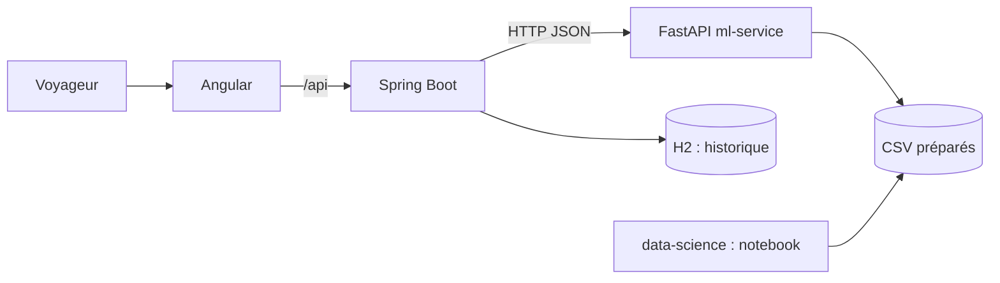

# Architecture

## Rôle de chaque composant
- **frontend** : collecte le profil, affiche lieux, scores, explications et itinéraire. Ne contient aucune logique métier.
- **backend** : valide les entrées (Bean Validation), relaie vers le service Python, enregistre un historique, convertit les pannes du service en erreurs HTTP claires (400, 422, 502, 503), expose OpenAPI.
- **ml-service** : toute l'intelligence (scoring, itinéraire, explications). Chargé en mémoire au démarrage (437 lieux).
- **data-science** : produit les tables propres que lit le service ; sert aussi à l'analyse et au rapport.

Choix : un service Python séparé évite de porter pandas/numpy en Java et permet de changer le modèle (embeddings, LLM) sans toucher au backend. Le JSON est en `snake_case` partout (Jackson configuré en conséquence).

## Score d'un lieu
`score = Σ poids × composante`, composantes dans [0, 1], poids renormalisés sur les composantes actives :

| Composante | Poids de base | Calcul |
|---|---|---|
| intérêts | 0,45 | poids déclaré de la catégorie du lieu / 5 |
| qualité | 0,25 | 0,7 × note du lieu normalisée + 0,3 × moyenne bayésienne des notes utilisateurs |
| budget | 0,15 | 1 si gratuit, sinon `1 − prix / (budget / (jours × 3))`, borné à [0, 1] |
| similarité | 0,15 | si l'utilisateur donne des lieux aimés : moitié item-item (notes), moitié contenu (catégorie, ville, tranche de prix) |

Filtres durs : ville, gratuit seulement, prix ≤ budget. Diversité : −0,04 par lieu déjà retenu de la même catégorie. Les explications (`reasons`) sont générées à partir de ces composantes et des champs du lieu, jamais inventées.

## Itinéraire
1. Candidats : meilleurs lieux de la ville (hors coordonnées suspectes).
2. Pour chaque jour : on part du meilleur lieu restant, puis on ajoute le lieu qui minimise `distance − 8 × score` tant que visite + trajet tiennent dans le temps du jour (480 min par défaut) et que le budget est respecté.
3. Trajet estimé : distance à vol d'oiseau, 25 km/h, 10 min de marge par déplacement.
4. Sorties : horaires, coûts, distance par jour, totaux, avertissements (jours non remplis, budget).

Hypothèses simplifiées : pas de pause déjeuner, pas d'horaires d'ouverture, distances à vol d'oiseau.
