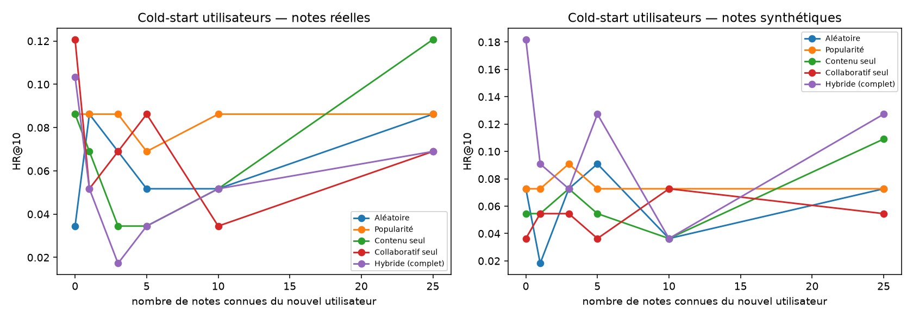

# Évaluation expérimentale — hybride vs approches seules vs popularité

Données : 300 utilisateurs, 437 lieux, 7680 notes d'entraînement, 1917 notes de test (20 % de chaque utilisateur). Pertinent = note >= 4 (40% des notes de test). Les lieux déjà notés à l'entraînement sont exclus des classements. Utilisateurs évalués : 281.

Profil de chaque utilisateur déduit de ses notes d'entraînement : poids d'intérêt par catégorie = note moyenne arrondie, lieux aimés = notes >= 4 (même protocole que `evaluate.py`). Toutes les méthodes sont départagées aléatoirement en cas d'égalité.

Approches : **Popularité** = nombre de notes ; **Qualité seule** = composante `quality` du moteur ; **Contenu seul** = composante `interests` ; **Collaboratif seul** = similarité item-item moyenne avec les lieux aimés ; **Hybride** = `Recommender.score` complet (intérêts + qualité + similarité) suivi de la diversification de `recommend`. `Hybride sans similarité` est l'ablation. Le budget n'est pas évalué ici : c'est une contrainte, pas un signal de préférence.

Fidélité du banc d'essai : le classement de l'hybride reproduit `Recommender.recommend()` (oui).

## 1. Résultats sur les notes réelles (K = 10)

| Méthode | Precision@10 | Recall@10 | HR@10 | NDCG@10 |
|---|---|---|---|---|
| Aléatoire | 0.008 | 0.032 | 0.075 [0.046; 0.107] | 0.021 [0.012; 0.031] |
| Popularité | 0.005 | 0.017 | 0.050 [0.025; 0.075] | 0.011 [0.004; 0.020] |
| Qualité seule | 0.006 | 0.023 | 0.057 [0.032; 0.085] | 0.014 [0.008; 0.023] |
| Contenu seul | 0.007 | 0.028 | 0.075 [0.046; 0.107] | 0.016 [0.010; 0.025] |
| Collaboratif seul | 0.008 | 0.037 | 0.082 [0.050; 0.114] | 0.019 [0.011; 0.029] |
| Hybride sans similarité | 0.008 | 0.033 | 0.075 [0.046; 0.107] | 0.020 [0.011; 0.030] |
| Hybride (complet) | 0.008 | 0.034 | 0.075 [0.046; 0.107] | 0.021 [0.012; 0.031] |
| Idéal (borne) | 0.270 | 1.000 | 1.000 [1.000; 1.000] | 1.000 [1.000; 1.000] |

Tests appariés (bootstrap sur les utilisateurs) :

| Comparaison (Hybride complet moins …) | Δ NDCG@10 [IC95 %] | p | Δ HR@10 [IC95 %] | p |
|---|---|---|---|---|
| Aléatoire | -0.0004 [-0.0136; +0.0129] | 0.969 | +0.000 [-0.039; +0.043] | 1.000 |
| Popularité | +0.0093 [-0.0044; +0.0220] | 0.166 | +0.025 [-0.018; +0.068] | 0.265 |
| Qualité seule | +0.0064 [-0.0030; +0.0159] | 0.216 | +0.018 [-0.014; +0.050] | 0.385 |
| Contenu seul | +0.0043 [-0.0068; +0.0154] | 0.477 | +0.000 [-0.039; +0.036] | 1.000 |
| Collaboratif seul | +0.0015 [-0.0098; +0.0125] | 0.779 | -0.007 [-0.046; +0.032] | 0.788 |

### Autres K (NDCG, HR)

| Méthode | NDCG@5 | HR@5 | NDCG@10 | HR@10 | NDCG@20 | HR@20 |
|---|---|---|---|---|---|---|
| Aléatoire | 0.017 | 0.053 | 0.021 | 0.075 | 0.026 | 0.121 |
| Popularité | 0.007 | 0.021 | 0.011 | 0.050 | 0.022 | 0.135 |
| Qualité seule | 0.011 | 0.036 | 0.014 | 0.057 | 0.025 | 0.132 |
| Contenu seul | 0.012 | 0.046 | 0.016 | 0.075 | 0.026 | 0.149 |
| Collaboratif seul | 0.011 | 0.032 | 0.019 | 0.082 | 0.028 | 0.146 |
| Hybride sans similarité | 0.013 | 0.036 | 0.020 | 0.075 | 0.026 | 0.117 |
| Hybride (complet) | 0.015 | 0.046 | 0.021 | 0.075 | 0.030 | 0.132 |

## 2. Au-delà de la précision (listes de 10, notes réelles)

| Méthode | Couverture@10 | Diversité intra-liste | Nouveauté (bits) | Gini | Catégories distinctes / 10 |
|---|---|---|---|---|---|
| Aléatoire | 1.000 | 0.706 | 4.06 | 0.211 | 4.14 |
| Popularité | 0.032 | 0.769 | 3.40 | 0.973 | 4.67 |
| Qualité seule | 0.032 | 0.805 | 4.03 | 0.976 | 5.72 |
| Contenu seul | 0.982 | 0.453 | 4.05 | 0.376 | 1.79 |
| Collaboratif seul | 0.998 | 0.712 | 4.07 | 0.254 | 4.19 |
| Hybride sans similarité | 0.105 | 0.728 | 3.99 | 0.951 | 3.81 |
| Hybride (complet) | 0.455 | 0.679 | 4.04 | 0.850 | 3.90 |

## 3. Contrôle positif : notes synthétiques avec un vrai signal (K = 10)

Mêmes paires utilisateur-lieu, même découpage, mais la note = 3 + affinité de l'utilisateur pour la catégorie + effet de la note du lieu + bruit. Si le banc d'essai fonctionne, les approches personnalisées doivent battre la popularité ici.

| Méthode | Precision@10 | Recall@10 | HR@10 | NDCG@10 |
|---|---|---|---|---|
| Aléatoire | 0.007 | 0.023 | 0.066 [0.036; 0.099] | 0.014 [0.007; 0.022] |
| Popularité | 0.007 | 0.028 | 0.062 [0.036; 0.091] | 0.023 [0.011; 0.038] |
| Qualité seule | 0.015 | 0.056 | 0.139 [0.099; 0.179] | 0.036 [0.024; 0.050] |
| Contenu seul | 0.011 | 0.050 | 0.102 [0.069; 0.139] | 0.030 [0.018; 0.044] |
| Collaboratif seul | 0.009 | 0.027 | 0.084 [0.051; 0.117] | 0.018 [0.011; 0.026] |
| Hybride sans similarité | 0.017 | 0.072 | 0.164 [0.120; 0.208] | 0.040 [0.027; 0.054] |
| Hybride (complet) | 0.012 | 0.052 | 0.120 [0.084; 0.161] | 0.032 [0.021; 0.046] |
| Idéal (borne) | 0.246 | 1.000 | 1.000 [1.000; 1.000] | 1.000 [1.000; 1.000] |

Tests appariés :

| Comparaison (Hybride complet moins …) | Δ NDCG@10 [IC95 %] | p | Δ HR@10 [IC95 %] | p |
|---|---|---|---|---|
| Aléatoire | +0.0180 [+0.0045; +0.0324] | 0.002 | +0.055 [+0.007; +0.099] | 0.024 |
| Popularité | +0.0093 [-0.0098; +0.0273] | 0.338 | +0.058 [+0.011; +0.102] | 0.014 |
| Qualité seule | -0.0037 [-0.0180; +0.0102] | 0.579 | -0.018 [-0.058; +0.022] | 0.461 |
| Contenu seul | +0.0024 [-0.0165; +0.0205] | 0.809 | +0.018 [-0.033; +0.066] | 0.521 |
| Collaboratif seul | +0.0140 [-0.0004; +0.0291] | 0.055 | +0.036 [-0.011; +0.084] | 0.158 |

Au-delà de la précision :

| Méthode | Couverture@10 | Diversité intra-liste | Nouveauté (bits) | Gini | Catégories distinctes / 10 |
|---|---|---|---|---|---|
| Aléatoire | 1.000 | 0.704 | 4.05 | 0.220 | 4.16 |
| Popularité | 0.034 | 0.769 | 3.40 | 0.973 | 4.66 |
| Qualité seule | 0.032 | 0.793 | 3.99 | 0.976 | 4.85 |
| Contenu seul | 0.973 | 0.440 | 4.06 | 0.445 | 1.56 |
| Collaboratif seul | 0.938 | 0.660 | 4.05 | 0.414 | 3.67 |
| Hybride sans similarité | 0.128 | 0.714 | 3.98 | 0.944 | 3.42 |
| Hybride (complet) | 0.414 | 0.642 | 4.02 | 0.870 | 3.36 |

## 4. Cold-start — nouveaux utilisateurs

20 % des utilisateurs sont retirés de l'entraînement (modèle refitté sans eux), 1 graine(s). On révèle n de leurs notes d'entraînement pour fabriquer leur profil ; le test est inchangé. n = 0 : aucun profil (le moteur n'a que la qualité). Moyenne sur les graines ; HR@10 / NDCG@10.

**Notes réelles** : HR@10 par nombre de notes connues

| Méthode | n=0 | n=1 | n=3 | n=5 | n=10 | n=25 |
|---|---|---|---|---|---|---|
| Aléatoire | 0.034 | 0.086 | 0.069 | 0.052 | 0.052 | 0.086 |
| Popularité | 0.086 | 0.086 | 0.086 | 0.069 | 0.086 | 0.086 |
| Qualité seule | 0.069 | 0.069 | 0.069 | 0.069 | 0.069 | 0.069 |
| Contenu seul | 0.086 | 0.069 | 0.034 | 0.034 | 0.052 | 0.121 |
| Collaboratif seul | 0.121 | 0.052 | 0.069 | 0.086 | 0.034 | 0.069 |
| Hybride sans similarité | 0.103 | 0.052 | 0.017 | 0.052 | 0.069 | 0.086 |
| Hybride (complet) | 0.103 | 0.052 | 0.017 | 0.034 | 0.052 | 0.069 |

**Notes synthétiques** : HR@10 par nombre de notes connues

| Méthode | n=0 | n=1 | n=3 | n=5 | n=10 | n=25 |
|---|---|---|---|---|---|---|
| Aléatoire | 0.073 | 0.018 | 0.073 | 0.091 | 0.036 | 0.073 |
| Popularité | 0.073 | 0.073 | 0.091 | 0.073 | 0.073 | 0.073 |
| Qualité seule | 0.182 | 0.182 | 0.182 | 0.182 | 0.182 | 0.182 |
| Contenu seul | 0.055 | 0.055 | 0.073 | 0.055 | 0.036 | 0.109 |
| Collaboratif seul | 0.036 | 0.055 | 0.055 | 0.036 | 0.073 | 0.055 |
| Hybride sans similarité | 0.182 | 0.091 | 0.091 | 0.109 | 0.182 | 0.164 |
| Hybride (complet) | 0.182 | 0.091 | 0.073 | 0.127 | 0.036 | 0.127 |

## 5. Cold-start — nouveaux lieux

15 % des lieux sont retirés des notes d'entraînement (aucune note, donc popularité = 0 et similarité collaborative = 0), 1 graine(s). Pertinent = lieu froid noté >= 4 dans le test. Protocole (a) : classement sur tout le catalogue, on mesure aussi la part de lieux froids dans le top-10 (15 % = proportion dans le catalogue). Protocole (b) : classement parmi les seuls lieux froids.

**Notes réelles — catalogue complet**

| Méthode | HR@10 | Recall@10 | NDCG@10 | Part de lieux froids dans le top-10 |
|---|---|---|---|---|
| Aléatoire | 0.010 | 0.010 | 0.003 | 0.14 |
| Popularité | 0.000 | 0.000 | 0.000 | 0.00 |
| Qualité seule | 0.020 | 0.020 | 0.010 | 0.09 |
| Contenu seul | 0.010 | 0.010 | 0.004 | 0.13 |
| Collaboratif seul | 0.000 | 0.000 | 0.000 | 0.00 |
| Hybride sans similarité | 0.010 | 0.010 | 0.006 | 0.08 |
| Hybride (complet) | 0.000 | 0.000 | 0.000 | 0.04 |

**Notes réelles — lieux froids seuls**

| Méthode | HR@10 | Recall@10 | NDCG@10 | Part de lieux froids dans le top-10 |
|---|---|---|---|---|
| Aléatoire | 0.250 | 0.215 | 0.089 | 1.00 |
| Popularité | 0.210 | 0.180 | 0.100 | 1.00 |
| Qualité seule | 0.170 | 0.155 | 0.074 | 1.00 |
| Contenu seul | 0.240 | 0.225 | 0.101 | 1.00 |
| Collaboratif seul | 0.160 | 0.150 | 0.080 | 1.00 |
| Hybride sans similarité | 0.200 | 0.175 | 0.071 | 1.00 |
| Hybride (complet) | 0.150 | 0.130 | 0.054 | 1.00 |

**Notes synthétiques — catalogue complet**

| Méthode | HR@10 | Recall@10 | NDCG@10 | Part de lieux froids dans le top-10 |
|---|---|---|---|---|
| Aléatoire | 0.021 | 0.021 | 0.021 | 0.14 |
| Popularité | 0.000 | 0.000 | 0.000 | 0.00 |
| Qualité seule | 0.063 | 0.058 | 0.022 | 0.09 |
| Contenu seul | 0.032 | 0.025 | 0.009 | 0.15 |
| Collaboratif seul | 0.000 | 0.000 | 0.000 | 0.00 |
| Hybride sans similarité | 0.021 | 0.016 | 0.008 | 0.07 |
| Hybride (complet) | 0.021 | 0.016 | 0.006 | 0.03 |

**Notes synthétiques — lieux froids seuls**

| Méthode | HR@10 | Recall@10 | NDCG@10 | Part de lieux froids dans le top-10 |
|---|---|---|---|---|
| Aléatoire | 0.253 | 0.219 | 0.098 | 1.00 |
| Popularité | 0.274 | 0.254 | 0.121 | 1.00 |
| Qualité seule | 0.263 | 0.240 | 0.132 | 1.00 |
| Contenu seul | 0.189 | 0.177 | 0.086 | 1.00 |
| Collaboratif seul | 0.189 | 0.168 | 0.086 | 1.00 |
| Hybride sans similarité | 0.316 | 0.293 | 0.128 | 1.00 |
| Hybride (complet) | 0.347 | 0.314 | 0.154 | 1.00 |

Latence : `recommend()` avec lieux aimés = 248 ms par requête (boucles `iterrows` dans la similarité de contenu).

Durée totale de l'évaluation : 306 s.
